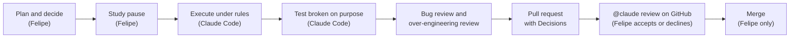

# engineering-workflow

How I build my study projects with an AI coding assistant (Claude Code).

I plan and decide. Claude executes under written rules. Every change goes
through tests, two automated review layers, a review on the pull request and
my merge. This repository holds the rules and tools that make that process
real, so it can be checked instead of taken on trust.

## The pipeline

| Stage | Who | How it is enforced or recorded |
|---|---|---|
| Plan and decide | Felipe | Claude presents options with pros and cons and waits for approval (rule 1). |
| Study pause | Felipe | Before a PR that touches an interview-level concept, Claude names it, what to read and questions to answer (rule 10). The answers are mine, published as written in [`learning/`](learning/) (rule 11). |
| Execute | Claude Code | Written rules in [`claude/CLAUDE.md`](claude/CLAUDE.md). New behaviour needs a test that is shown to fail when the code is broken on purpose (rule 4). |
| Local review | Claude Code | `code-review` for bugs, then `ponytail-review` to cut what does not need to exist (rule 9). A [hook](claude/hooks/ponytail-before-commit.ps1) reminds Claude before every commit. |
| Pull request | Claude Code drafts, Felipe checks | A "Decisions" section separates what I decided, what Claude proposed and I approved, and what came from review (rule 12). |
| Review on GitHub | `@claude` + Felipe | A GitHub Action ([`github/claude.yml`](github/claude.yml)) reviews the PR against the repo's `CLAUDE.md` when I mention `@claude`. I decide what to apply. |
| Merge | Felipe only | Claude Code is denied `gh pr merge` and pushes to `main` ([`claude/settings.example.json`](claude/settings.example.json)). |

My local workspace imports [`claude/CLAUDE.md`](claude/CLAUDE.md), and its
hook runs from this repository, so what is published here is what is in use.

## Example

[saraivas/orbitdesk-api#7](https://github.com/saraivas/orbitdesk-api/pull/7)
shows the execution and review stages: tests for an endpoint that had none,
an audit log write proven atomic by a test that fails when the code is broken
on purpose, a duplicated helper cut by the over-engineering review, and an
`@claude` review where two findings were accepted and four were declined with
reasons. The study pause and the "Decisions" section became rules while that
PR was open, so its Decisions section was added after the merge and says so.

## Limits

- Rules in `CLAUDE.md` are context for Claude, not enforcement. Only the
  permission rules and the hook are enforced by Claude Code, and the hook
  only reminds; it does not block a commit.
- The hook and the permission rules apply to commands Claude runs, not to
  commands I run in my own terminal.
- The `@claude` review job has no database, so it cannot run the test
  suite; test results come from each project's CI.
